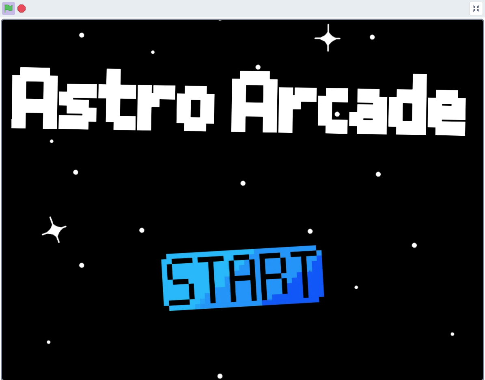
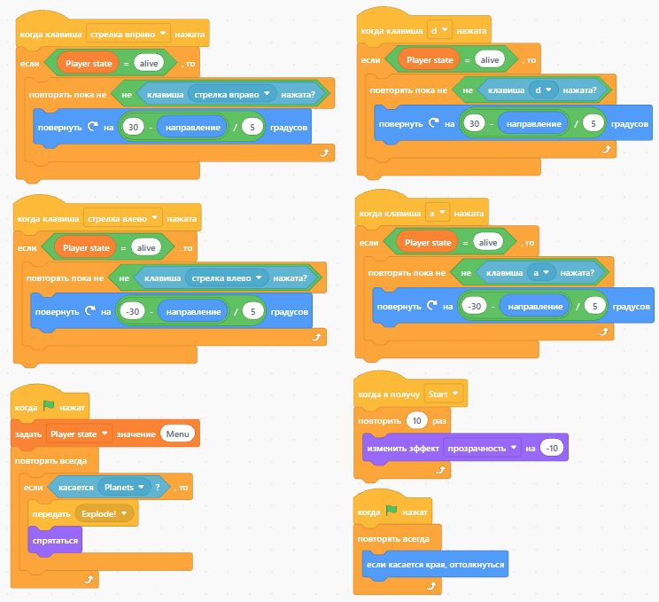

Kosmo-Arcade
Учебный проект по Scratch

[▶ Запустить игру](https://ttmp-0.github.io/Kosmo-Ship/)

Это пример учебного проекта, который создаётся на занятиях по программированию в Scratch.

Проект представляет собой небольшую аркадную игру, в которой игрок управляет ракетой. Ракета автоматически движется вперёд, а навстречу ей летят кометы. Задача игрока — вовремя уворачиваться от препятствий с помощью стрелок на клавиатуре и набрать как можно больше очков.

Во время работы над проектом ученики постепенно изучают новые элементы программирования и сразу применяют их на практике. В результате отдельные блоки и конструкции Scratch объединяются в полноценную работающую игру, которую можно запустить, протестировать и показать другим.

Что такое Scratch:  
Scratch — это визуальная среда программирования, созданная для обучения детей основам программирования и алгоритмического мышления.

Вместо написания программ с помощью текстового кода ребёнок собирает программу из визуальных блоков. Благодаря этому можно сосредоточиться на понимании логики программирования, не отвлекаясь на сложный синтаксис языка.

Scratch хорошо подходит для первых шагов в программировании, поскольку результат работы можно сразу увидеть в виде игры, анимации или интерактивного проекта.
Чем полезен Scratch и программирование
Создание проектов в Scratch помогает развивать навыки, которые необходимы для дальнейшего изучения программирования:
- алгоритмическое и логическое мышление;
- понимание последовательности действий;
- работу с условиями и циклами;
- использование переменных;
- умение разбивать большую задачу на отдельные части;
- поиск и исправление ошибок;
- самостоятельное решение задач;
- умение последовательно доводить идею до готового результата.
При этом ребёнок получает понятный и наглядный результат своей работы — собственную игру, которую можно запустить, протестировать, изменить и показать другим.

О проекте:  
В этой игре игрок управляет космической ракетой.
В игре также предусмотрены музыка, старт игры и возможность начать игру заново.
Что изучает ребёнок на этом проекте
При создании проекта ребёнок знакомится с различными элементами программирования и учится применять их для решения конкретной игровой задачи.

В проекте используются:  
- управление с клавиатуры;
- движение объектов;
- работа с координатами;
- условия;
- циклы;
- переменные;
- случайные значения;
- взаимодействие и столкновение объектов;
- подсчёт очков;
- игровые события;
- звуки и музыка;
- создание стартового экрана;
- перезапуск игры.

Скриншоты  
Стартовый экран  

Перед началом игры появляется меню, чтобы игрок мог сам решить, когда запустить игру.

Игровой процесс  

В игровом процессе необходимо уворачиваться от комет, за каждый уворот, засчитываются очки. При столкновении с препятствием, игра заканчивается.

Программная логика  

В проекте осуществлено как управление стрелками, так и клавишами "a" и "d", в связи с особенностями языка Scratch, для доступности альтернативного управления требуется сменить раскладку клавиатуры на английский язык. Реализовано столкновение с кометой с помощью условных операторов, при значении истинности "true", срабатывает звук столкновения и ракета исчезает, отправляется сигнал другим спрайтам, для появления меню рестарта игры.

Результат
В результате ученик получает собственную законченную игру, в которой объединены несколько изученных элементов программирования.

Для ребёнка это не просто набор отдельных упражнений с блоками Scratch, а полноценный проект с понятной целью и видимым результатом. Игру можно запустить, протестировать, показать другим и при желании самостоятельно изменить или дополнить.
Подобные проекты используются как практическая часть обучения программированию.

Ребёнок изучает новые конструкции не изолированно, а сразу применяет их для создания работающей игры. Это позволяет постепенно переходить от отдельных простых задач к более сложным проектам, где необходимо самостоятельно объединять несколько элементов программы и получать из них законченный результат.
